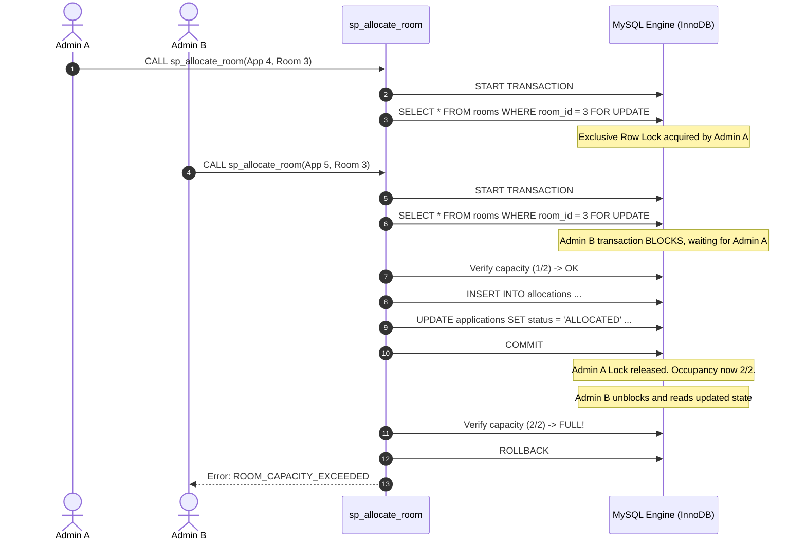

# Advanced DBMS Concepts & Architectural Implementation

This document provides a comprehensive technical breakdown of the database concepts implemented in the **Smart PG/Hostel Room Allocation and Occupancy Management System**.

---

## 1. Relational Schema & Integrity Constraints

All tables are implemented in MySQL 8.0+ using the **InnoDB storage engine** ([`database/schema.sql`](file:///c:/Users/Qamar/Downloads/smart-pg-hostel-management/database/schema.sql)).

### 1.1 Primary & Foreign Key Integrity
- Every entity utilizes an explicit, surrogate auto-increment primary key (`user_id`, `hostel_id`, `room_type_id`, `room_id`, `application_id`, `allocation_id`).
- Referential integrity is enforced with precise `ON DELETE` and `ON UPDATE` actions:
  - `rooms.hostel_id` -> `hostels.hostel_id` (`ON DELETE CASCADE`): Deleting a hostel removes associated rooms.
  - `rooms.room_type_id` -> `room_types.room_type_id` (`ON DELETE RESTRICT`): Prevents deleting a room category if active physical rooms are assigned to it.
  - `allocations.application_id` -> `applications.application_id` (`ON DELETE RESTRICT`): Preserves financial and occupancy audit history.

### 1.2 Multi-Column Uniqueness & Domain Constraints
- **Hostel-Room Uniqueness:** `UNIQUE KEY uq_hostel_room_number (hostel_id, room_number)` ensures room numbers like "101" can coexist across different hostels without collisions within the same building.
- **Application Allocation Uniqueness:** `UNIQUE KEY uq_allocations_application (application_id)` guarantees an application can never be allocated more than once.
- **Domain CHECK Constraints:**
  - `chk_room_types_capacity`: `capacity > 0`
  - `chk_room_types_rent`: `monthly_rent >= 0.00`
  - `chk_rooms_floor`: `floor >= 0`

---

## 2. Real-Time Occupancy View (`room_occupancy_summary`)

Location: [`database/views.sql`](file:///c:/Users/Qamar/Downloads/smart-pg-hostel-management/database/views.sql)

```sql
CREATE OR REPLACE VIEW room_occupancy_summary AS
SELECT 
  r.room_id,
  r.hostel_id,
  h.hostel_name,
  r.room_number,
  r.floor,
  rt.room_type_id,
  rt.type_name,
  rt.capacity,
  rt.monthly_rent,
  COUNT(CASE WHEN a.status = 'ACTIVE' THEN a.allocation_id END) AS occupied_beds,
  (rt.capacity - COUNT(CASE WHEN a.status = 'ACTIVE' THEN a.allocation_id END)) AS available_beds,
  r.status AS physical_status,
  CASE 
    WHEN r.status = 'UNDER_MAINTENANCE' THEN 'UNDER_MAINTENANCE'
    WHEN (rt.capacity - COUNT(CASE WHEN a.status = 'ACTIVE' THEN a.allocation_id END)) <= 0 THEN 'FULL'
    ELSE 'AVAILABLE'
  END AS occupancy_status
FROM rooms r
JOIN hostels h ON r.hostel_id = h.hostel_id
JOIN room_types rt ON r.room_type_id = rt.room_type_id
LEFT JOIN allocations a ON r.room_id = a.room_id AND a.status = 'ACTIVE'
GROUP BY 
  r.room_id, r.hostel_id, h.hostel_name, r.room_number, r.floor,
  rt.room_type_id, rt.type_name, rt.capacity, rt.monthly_rent, r.status;
```

### DBMS Design Rationale:
1. **`LEFT JOIN` on Active Allocations:** Rooms with zero occupants still appear in query results with `occupied_beds = 0` and `available_beds = capacity`.
2. **Dynamic Computation:** Bed availability is derived from live active allocation rows rather than maintaining a redundant counter, eliminating data anomalies.
3. **Unified Business Status:** Synthesizes physical room status (`UNDER_MAINTENANCE`) with mathematical occupancy (`FULL` vs `AVAILABLE`).

---

## 3. Concurrency Control & ACID Transactions (`sp_allocate_room`)

Location: [`database/procedures.sql`](file:///c:/Users/Qamar/Downloads/smart-pg-hostel-management/database/procedures.sql)

### The Problem: Race Conditions in Bed Allocation
When two administrators attempt to allocate the final remaining bed in a room simultaneously:
1. Admin A reads `occupied_beds = 1`, `capacity = 2` (1 bed available).
2. Admin B reads `occupied_beds = 1`, `capacity = 2` (1 bed available).
3. Admin A inserts an allocation.
4. Admin B inserts an allocation.
5. **Result:** Room occupancy becomes 3/2, violating physical capacity.

### The Solution: Pessimistic Locking with `SELECT ... FOR UPDATE`
The stored procedure `sp_allocate_room` enforces serializability:



---

## 4. Database Triggers (Defense-in-Depth)

Location: [`database/triggers.sql`](file:///c:/Users/Qamar/Downloads/smart-pg-hostel-management/database/triggers.sql)

Triggers act as an engine-level safeguard against rogue scripts or direct manual SQL queries:

1. **`trg_before_allocation_insert`:**
   - Evaluates target room maintenance status.
   - Verifies the student does not already hold another `ACTIVE` allocation in the system.
   - Calculates active occupant count; fires `SIGNAL SQLSTATE '45000'` with a custom error message if capacity is exceeded.
2. **`trg_after_allocation_insert`:**
   - Synchronizes `rooms.status` to `'OCCUPIED'` when the last available bed in a room is allocated.
3. **`trg_before_allocation_update`:**
   - Re-validates room capacity if an inactive allocation is toggled back to `'ACTIVE'`.
4. **`trg_after_allocation_update`:**
   - Automatically marks a room back to `'AVAILABLE'` when an active allocation is terminated or vacated.

---

## 5. Strategic Indexing

Location: [`database/schema.sql`](file:///c:/Users/Qamar/Downloads/smart-pg-hostel-management/database/schema.sql)

- **`idx_rooms_hostel_status (hostel_id, status)`:** Optimizes student and admin room browsing filters (e.g., "Find all AVAILABLE rooms in Hostel 1").
- **`idx_allocations_room_status (room_id, status)`:** Optimizes view aggregations and active bed counting during procedure lock verification.
- **`idx_applications_student_status (student_id, status)`:** Accelerates student dashboard queries for personal application status.

---

## 6. Polyglot Architecture: MySQL vs MongoDB

| Architectural Attribute | MySQL 8+ (Primary Store) | MongoDB Atlas (Secondary Store) |
| :--- | :--- | :--- |
| **Role** | Core transactional data store | Flexible audit and activity log store |
| **Entities** | Users, Hostels, Rooms, Applications, Allocations | `activity_logs` collection |
| **ACID Guarantees** | Strict multi-table ACID transactions, row-level locks | Append-only document writes, high write throughput |
| **Integrity** | Foreign keys, constraints, triggers, stored procedures | Schemaless embedded metadata (`details: {}`) |
| **Query Engine** | Relational JOINs, GROUP BY, Materialized Views | Aggregation Pipelines (`$group`, `$match`, `$sort`) |

---

## 7. MongoDB Indexing Strategy (`activity_logs`)

Location: [`src/lib/logger/index.ts`](file:///c:/Users/Qamar/Downloads/smart-pg-hostel-management/src/lib/logger/index.ts)

Instead of over-indexing every field, five targeted indexes were created to match our query patterns:

1. **`{ timestamp: -1 }` (`idx_activity_timestamp_desc`):**  
   Powers reverse-chronological event feeds, time-range filters, and most-recent event queries without full collection scans.
2. **`{ action: 1 }` (`idx_activity_action`):**  
   Optimizes dashboard event filtering and the `$group` stage in our analytics aggregation pipeline.
3. **`{ performedBy: 1 }` (`idx_activity_performedBy`):**  
   Enables fast audit lookups for actions initiated by a specific administrator or student.
4. **`{ targetType: 1 }` (`idx_activity_targetType`):**  
   Enables indexing by entity domain (`room`, `application`, `allocation`, `user`).
5. **`{ studentId: 1 }` (`idx_activity_studentId`):**  
   Accelerates student-specific timeline requests.

---

## 8. MongoDB Aggregation Pipeline

Location: Reserved for teammate in [`FRIEND_TASKS.md`](file:///c:/Users/Qamar/Downloads/smart-pg-hostel-management/FRIEND_TASKS.md) and verified in `scripts/verify-phase3.mjs`

To summarize system activity into operational metrics without placing analytical load on MySQL:

```javascript
const summary = await collection.aggregate([
  {
    $group: {
      _id: "$action",
      totalEvents: { $sum: 1 },
      lastOccurred: { $max: "$timestamp" }
    }
  },
  {
    $sort: { totalEvents: -1 }
  }
]).toArray();
```

### DBMS Concepts Demonstrated:
- **`$group`:** Groups unstructured log streams by action type (equivalent to SQL `GROUP BY`).
- **`$sum` & `$max`:** Computes aggregate event frequencies and recent timestamps.
- **`$sort`:** Sorts results in descending order of event volume.

---

## 9. Dual-Database Consistency: Post-Commit Reliability

In a polyglot setup without distributed 2-phase commit overhead, we follow a strict **Post-Commit Reliability Model**:

1. **MySQL is the Absolute Source of Truth:**  
   Every business state change (application approval, bed allocation, vacancy update) MUST successfully commit in MySQL before any log is written.
2. **Non-Blocking Audit Logging:**  
   MongoDB logging runs *after* the MySQL transaction has committed. If MongoDB is experiencing a momentary latency spike or network glitch, the failure is caught and logged to server output, but it never aborts or reverses the valid MySQL transaction.
3. **Known Boundary / Trade-off:**  
   If the Node.js server process crashes in the few milliseconds between the MySQL `COMMIT` and the MongoDB `insertOne()`, an audit log entry could be missed. This conscious engineering trade-off prioritizes relational data consistency over distributed lock overhead.
